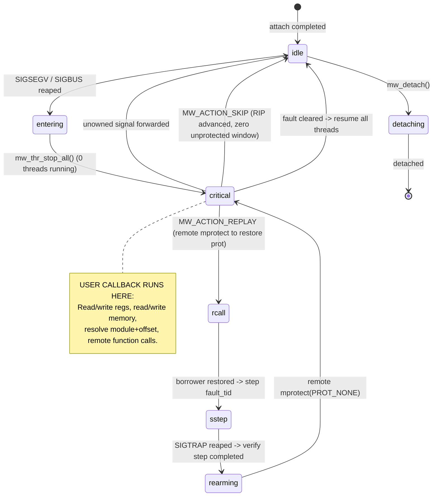

# Architecture Specification: The Execution Interceptor

`libmemwatch` is a lean, page-fault-driven **Execution Interceptor & Memory Watchpoint Engine** for Linux **x86_64**. It enables attaching watchpoints over arbitrary memory ranges without hardware debug registers (`DR0`–`DR7`), binary rewriting, or target cooperation.

When a watched memory access occurs, `libmemwatch` freezes the target universe, quells concurrent thread races, and hands the caller an **isolated ptrace execution interceptor session**. Inside the callback, the user has direct, low-level freedom:
* **Inspect & Modify Machine Registers**: Direct access to `struct user_regs_struct` (`rip`, `rax`, `rsp`, flags).
* **Direct Virtual Memory Access**: Fast, zero-copy `process_vm_readv/writev` reads and writes into the stopped target.
* **Symbolic Address Resolution**: Translate raw addresses (e.g., `0x7f...`) into human-readable locations like `libxyz.so+0x1120` using `/proc/<pid>/maps` without external debug symbol dependencies.
* **Target Function Execution**: Invoke target functions synchronously on demand and retrieve return values.
* **Actionable Continuations**: Choose whether to replay the faulting instruction (step & re-arm), skip/emulate it (advance `rip` without dropping `PROT_NONE`), or disarm the watch.

The process linking `libmemwatch` acts as the parent-tracer (`ptrace`). Under Yama LSM (`ptrace_scope=1`), the target must be an immediate child of the tracer process.

---

## 1. The Interceptor Model: Lean & Powerful

Instead of heavy debugger abstractions, `libmemwatch` focuses on providing a clean, low-level sandbox when a page fault occurs:

```
+---------------------------------------------------------------------------------------+
| FROZEN EXECUTION SANDBOX (Inside the Watch Callback)                                  |
|                                                                                       |
|   Target Status:          100% FROZEN (mw_thr_count_running == 0)                     |
|   Faulting Thread:        Halted at faulting RIP, registers intact                    |
|   Sibling Threads:        Halted in ptrace group-stop, zero instructions running      |
|   Memory Security:        Watched pages remain PROT_NONE (no concurrent leaks)        |
|                                                                                       |
|   CORE INTERCEPTOR TOOLS:                                                             |
|   [x] mw_regs_get() / mw_regs_set()   -> Direct user_regs_struct manipulation         |
|   [x] mw_read_mem() / mw_write_mem() -> Fast memory read/write (process_vm_readv)     |
|   [x] mw_addr_resolve()              -> Resolves 0x7f... to "libc.so.6+0x280e0"       |
|   [x] mw_remote_call()               -> Synchronous function call inside target       |
|                                                                                       |
|   CONTINUATION CHOICES:                                                               |
|   (A) MW_ACTION_REPLAY: Unprotect -> Single-step insn -> Re-protect PROT_NONE -> Resume|
|   (B) MW_ACTION_SKIP:   User handled it / bumped RIP -> Keep PROT_NONE -> Resume      |
|   (C) MW_ACTION_DISARM: Permanently unprotect and drop watchpoint -> Resume           |
+---------------------------------------------------------------------------------------+
```

---

## 2. Foundational Primitives

1. **Virtual Memory Trap Barrier (`mprotect`)**:
   Marking pages `PROT_NONE` causes the CPU MMU to trap any memory access. The Linux kernel generates a thread-directed `SIGSEGV` or `SIGBUS` with `si_addr` identifying the touched address and `regs.rip` pointing directly to the faulting instruction.
2. **Deterministic Universe Freeze (`PTRACE_SEIZE` + `PTRACE_INTERRUPT`)**:
   `PTRACE_SEIZE` attaches without stopping tracees or synthesizing artificial signals. On a trap, `PTRACE_INTERRUPT` is sent to all threads. The tracer drains wait events until `mw_thr_count_running() == 0`, ensuring no sibling threads execute during inspection.
3. **Dedicated Code Cave & Stackless Stubs**:
   A private `PROT_READ|WRITE|EXEC` page (`stub_page`) allocated via a bootstrap gadget allows synthesizing atomic syscalls and function invocation frames without corrupting the application stack.

---

## 3. The Low-Level State Machine (`mw_state_t`)



### The Power of `MW_ACTION_SKIP` (Zero-Window Emulation)
If the user callback emulates the instruction (e.g. updating a destination register) and advances `regs.rip`:
* The watched page **never needs to be unprotected**.
* No remote `mprotect` is executed.
* No `PTRACE_SINGLESTEP` window is created.
* Concurrent threads never get a microscopic window where memory is unprotected.

---

## 4. Symbolic Address Resolution: Mapping via `/proc/<pid>/maps`

To avoid pulling in heavy DWARF or ELF symbolication libraries, `libmemwatch` leverages the target's `/proc/<pid>/maps` (which it already parses for page protection tracking).

Given any address (e.g., `regs.rip` or `fault_addr`), [`mw_addr_resolve()`](file:///c:/Users/User/Documents/lab/libmemwatch/include/memwatch/api.hpp) formats a concise, human-readable identifier:

$$\text{Address } (0\text{x}7\text{ffff7dd2120}) \longrightarrow \text{"libc.so.6+0x28120"}$$

### Resolution Rules:
* **File-backed mappings**: `"<basename>+0x<offset>"` (e.g., `libcrypto.so.3+0x4a100`, `my_app+0x1120`).
* **Special kernel segments**: `"[heap]+0x1040"`, `"[stack]+0x210"`, `"[vdso]+0x800"`.
* **Anonymous mappings**: `"[anon:0x7ffff7a00000]+0x400"`.

This gives the user immediate context on what library or module triggered the access without external dependencies.

---

## 5. Dependency Analysis & High-Leverage Integrations

To keep the core engine small, robust, and zero-bloat while providing an elite user experience, dependencies are split into **Zero-Dependency Built-ins** and **Recommended Companion Libraries**:

```
+-------------------------------------------------------------------------------+
| DEPENDENCY TAXONOMY                                                           |
|                                                                               |
| [1] Core Engine (Zero Dependencies):                                          |
|     * Linux ptrace, /proc/<pid>/maps, process_vm_readv/writev                 |
|     * Built-in maps address resolution ("module+offset")                      |
|                                                                               |
| [2] Optional Disassembly Leverage: Capstone Engine                            |
|     * Single C library dependency: libcapstone                                |
|     * Decodes instruction at regs.rip                                         |
|     * Gives exact insn.size (makes regs.rip += insn.size trivial for SKIP)    |
|     * Disassembles mnemonics & operands (e.g., "mov rax, [rbx+0x10]")        |
|                                                                               |
| [3] Future Interactive Console Leverage: Linenoise                            |
|     * Minimalist readline replacement (<1,000 lines of pure C)                |
|     * Zero external dependencies (no ncurses/readline bloat)                  |
|     * Powers an interactive break shell inside watch callbacks                |
+-------------------------------------------------------------------------------+
```

### Why Capstone is the Ideal Companion:
* **Instruction Sizing**: On x86_64, variable-length instructions (1 to 15 bytes) make advancing `regs.rip` error-prone if done manually. With Capstone:
  ```c
  csh handle;
  cs_insn *insn;
  cs_open(CS_ARCH_X86, CS_MODE_64, &handle);
  uint8_t code[16];
  mw_read_mem(ctx, regs.rip, code, sizeof(code));
  if (cs_disasm(handle, code, sizeof(code), regs.rip, 1, &insn) > 0) {
      printf("[HOOK] %s %s (size=%d)\n", insn[0].mnemonic, insn[0].op_str, insn[0].size);
      // To skip:
      regs.rip += insn[0].size;
      mw_regs_set(ctx, tid, &regs);
      cs_free(insn, 1);
  }
  cs_close(&handle);
  ```
* **Clean Boundary**: `libmemwatch` remains pure systems C/C++; Capstone can be used by the consumer or linked as an optional helper.

---

## 6. Public C API Specification (`include/memwatch/api.hpp`)

```c
#ifdef __cplusplus
extern "C" {
#endif

/* Callback actions determining continuation */
typedef enum {
  MW_ACTION_REPLAY = 0, /* Unprotect, single-step faulting insn, re-arm, resume */
  MW_ACTION_SKIP   = 1, /* User emulated access / bumped RIP: keep PROT_NONE, resume */
  MW_ACTION_DISARM = 2, /* Remove watchpoint permanently, restore memory, resume */
  MW_ACTION_KILL   = 3, /* Terminate target process */
} mw_action_t;

/* Compact interceptor context */
typedef struct {
  pid_t               tid;        /* Faulting thread ID */
  uintptr_t           addr;       /* Exact fault address (si_addr) */
  pg_t                p;          /* Page-aligned fault address */
  int                 si_code;    /* SEGV_MAPERR or SEGV_ACCERR */
  unsigned long long  rip;        /* Faulting instruction pointer */
  mw_watch_t         *watch;      /* Owning watchpoint */
} mw_intercept_t;

typedef mw_action_t (*mw_callback_t)(mw_ctx_t *ctx, const mw_intercept_t *ic, void *ud);

/* --- Lifecycle & Attachment --- */
rc_t mw_ctx_init(mw_ctx_t **out);
rc_t mw_ctx_free(mw_ctx_t *ctx);
rc_t mw_attach(mw_ctx_t *ctx, pid_t pid);
rc_t mw_detach(mw_ctx_t *ctx);

/* --- Watch Management --- */
rc_t mw_watch_add(mw_ctx_t *ctx, uintptr_t base, size_t size, mw_callback_t cb, void *ud);
rc_t mw_watch_del(mw_ctx_t *ctx, uintptr_t base, size_t size);
rc_t mw_watch_del_all(mw_ctx_t *ctx);

/* --- Low-Level Interceptor Tools (Callable from inside callback) --- */
rc_t    mw_regs_get(mw_ctx_t *ctx, pid_t tid, struct user_regs_struct *out);
rc_t    mw_regs_set(mw_ctx_t *ctx, pid_t tid, const struct user_regs_struct *in);
ssize_t mw_read_mem(mw_ctx_t *ctx, uintptr_t addr, void *buf, size_t len);
ssize_t mw_write_mem(mw_ctx_t *ctx, uintptr_t addr, const void *buf, size_t len);

/* Resolves an address to "module+0xoffset" via /proc/<pid>/maps */
rc_t    mw_addr_resolve(mw_ctx_t *ctx, uintptr_t addr, char *buf, size_t buf_len);

/* Remote function execution inside the stopped target */
rc_t    mw_remote_call(mw_ctx_t *ctx, pid_t tid, uintptr_t func_addr,
                       const unsigned long *args, size_t nargs, unsigned long *out_ret);

/* --- Event Loop --- */
rc_t mw_poll(mw_ctx_t *ctx, int timeout_ms);
rc_t mw_run(mw_ctx_t *ctx);
bool mw_target_exit(const mw_ctx_t *ctx, int *wait_status);

#ifdef __cplusplus
}
#endif
```

---

## 7. Concrete Use Case Examples

### Example A: Pretty Address Logging & Memory Read
```c
mw_action_t on_watch(mw_ctx_t *ctx, const mw_intercept_t *ic, void *ud) {
    char rip_sym[128];
    char addr_sym[128];
    uint64_t val = 0;

    mw_addr_resolve(ctx, ic->rip, rip_sym, sizeof(rip_sym));
    mw_addr_resolve(ctx, ic->addr, addr_sym, sizeof(addr_sym));
    mw_read_mem(ctx, ic->addr, &val, sizeof(val));

    printf("[WATCH] TID %d at %s touched %s (val=0x%lx)\n",
           ic->tid, rip_sym, addr_sym, val);

    return MW_ACTION_REPLAY; // Let it run
}
```

### Example B: Emulated Read with Capstone (Skipping Instruction)
```c
mw_action_t on_secret_read(mw_ctx_t *ctx, const mw_intercept_t *ic, void *ud) {
    struct user_regs_struct regs;
    mw_regs_get(ctx, ic->tid, &regs);

    // Using Capstone to find instruction length
    csh cs;
    cs_insn *insn;
    uint8_t code[16];
    mw_read_mem(ctx, regs.rip, code, sizeof(code));
    
    cs_open(CS_ARCH_X86, CS_MODE_64, &cs);
    if (cs_disasm(cs, code, sizeof(code), regs.rip, 1, &insn) > 0) {
        printf("[INTERCEPT] Suppressing read at %s (opcode: %s)\n",
               insn[0].mnemonic, insn[0].op_str);
        
        // Supply spoofed return value and advance RIP
        regs.rax = 0x1337;
        regs.rip += insn[0].size;
        mw_regs_set(ctx, ic->tid, &regs);
        
        cs_free(insn, 1);
    }
    cs_close(&cs);

    // Skip single-step: page stays PROT_NONE, no race window!
    return MW_ACTION_SKIP;
}
```

### Example C: The Interactive Console Blueprint
Because the callback executes while all threads are stopped, dropping into an interactive shell via Linenoise is trivial:
```c
mw_action_t on_debug_prompt(mw_ctx_t *ctx, const mw_intercept_t *ic, void *ud) {
    char sym[128];
    mw_addr_resolve(ctx, ic->rip, sym, sizeof(sym));
    printf("memwatch-shell [%s] > ", sym);

    char *line;
    while ((line = linenoise(">> ")) != NULL) {
        if (strcmp(line, "c") == 0) break; // Continue
        if (strcmp(line, "regs") == 0) {
            struct user_regs_struct r;
            mw_regs_get(ctx, ic->tid, &r);
            printf("RAX: 0x%llx RBX: 0x%llx RIP: 0x%llx\n", r.rax, r.rbx, r.rip);
        }
        free(line);
    }
    return MW_ACTION_REPLAY;
}
```